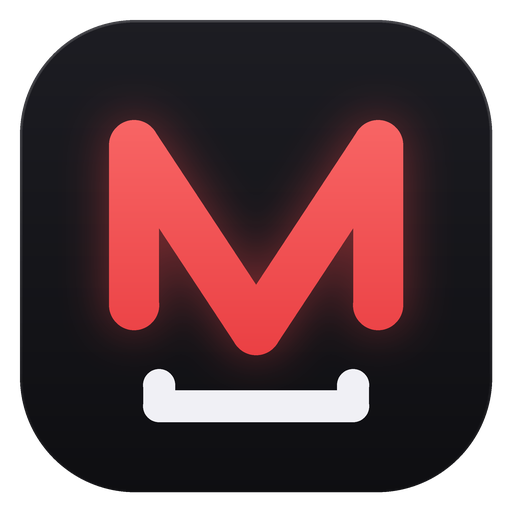

<p align="center">
  
</p>

<h1 align="center">MyTs</h1>
<p align="center"><b>Mixio YouTube Stuff</b> — a clean, modern YouTube video &amp; audio downloader with an animated intro.</p>

<p align="center">
  
  
  
  
</p>

---

MyTs is a desktop app built with **PySide6 (Qt)** and powered by **[yt-dlp](https://github.com/yt-dlp/yt-dlp)**. Paste a link, pick a format and hit download. Output is **Premiere Pro friendly** out of the box: H.264 + AAC in MP4 for video, and MP3 / M4A / WAV for audio.

<!-- Add a screenshot here, e.g.:
<p align="center"></p>
-->

## Features

- **Video or audio** — video up to 2160p (Best, 2160p, 1440p, 1080p, 720p, 480p, 360p) or audio as MP3, M4A or WAV
- **Premiere Pro ready** — audio is always AAC/MP3/WAV (never Opus/Vorbis), and AV1/VP9 video is automatically converted to H.264
- **Playlist support** — paste a playlist link (or a video from a playlist and choose "whole playlist" or "just this video"); playlist items go into their own subfolder
- **Download queue** — up to 3 downloads in parallel, the rest wait in the queue; failed downloads can be retried
- **Auto from clipboard** — optional switch that downloads every YouTube link you copy
- **Drag &amp; drop** — drop a link onto the window
- **Download library** — your history is saved with thumbnails; open the file, reveal it in the folder, copy the link, or delete it from the list / disk
- **Animated UI** — intro splash, smooth hover/progress/list animations
- **English &amp; Polish** — English by default; switch language any time from the dropdown in the top-right corner (your choice is remembered)

## Download

Grab the latest `MyTs-Windows.zip` from the [Releases](../../releases) page (or from the **Actions** tab → *Build Windows app* → artifacts), unzip it and run `MyTs.exe`. ffmpeg is bundled, so there is nothing else to install.

## Run from source

Requirements: **Python 3.10+** and **ffmpeg** (with `ffprobe`).

```bash
git clone https://github.com/<your-username>/MyTs.git
cd MyTs
pip install -r requirements.txt
python app.py
```

**About ffmpeg:** without it MyTs can't merge video and audio at 1080p+, create MP3/WAV, or convert videos to H.264. If ffmpeg isn't found at startup, the app asks whether you have it and lets you point to the `ffmpeg` / `ffprobe` folder (the location is remembered). On macOS you can install it with `brew install ffmpeg`; on Linux use your package manager.

## Build a standalone app

On Windows, double-click **`build.bat`**, or run:

```bash
python build.py
```

The script installs the dependencies and PyInstaller, downloads ffmpeg and bundles it with the app. Output:

- `dist/MyTs/MyTs.exe`
- `dist/MyTs-Windows.zip`

### GitHub Actions

`.github/workflows/build.yml` builds the Windows app on every `v*` tag (or manually via *Run workflow*) and uploads `MyTs-Windows.zip` as an artifact.

## Usage tips

| Action | How |
| --- | --- |
| Download a video | Paste a link → choose **Video** + quality → **Download** |
| Download audio only | Switch to **Audio** → choose MP3 / M4A / WAV |
| Change the target folder | Click the **Folder** button next to the quality selector |
| Change the language | Use the language dropdown in the top-right corner |
| Remove finished items | **Clear finished** (or the `•••` menu on a single item) |

Settings and the download library are stored in `~/.ytdl_app/` (library and thumbnails) and in your OS settings store (folder, format, language, ffmpeg location).

## Project structure

```
MyTs/
├── app.py                      # the whole application (UI, workers, translations)
├── build.py / build.bat        # PyInstaller build script (bundles ffmpeg)
├── requirements.txt
├── assets/                     # logo.png, icon.ico
├── tools/make_logo.py          # regenerates the logo and icon (needs Pillow)
└── .github/workflows/build.yml # Windows build in CI
```

### Adding a language

All UI texts live in the `TEXTS` dictionary near the top of `app.py`. To add a language, copy the `"en"` block under a new key (e.g. `"de"`), translate the values, and add it to `LANGUAGES`:

```python
LANGUAGES = {"en": "English", "pl": "Polski", "de": "Deutsch"}
```

Missing keys automatically fall back to English.

## Disclaimer

MyTs is intended for downloading content you have the right to download (your own uploads, Creative Commons material, etc.). You are responsible for complying with YouTube's Terms of Service and the copyright laws that apply to you. This project is not affiliated with YouTube or Google.

## License

MyTs' own source code is released under the [MIT License](LICENSE).

The app builds on third-party software that has its own licenses: yt-dlp (Unlicense), PySide6/Qt (LGPL-3.0) and FFmpeg (the Windows build bundles a GPL build of ffmpeg). If you redistribute the packaged app, keep their license notices with it.

## Credits

- [yt-dlp](https://github.com/yt-dlp/yt-dlp) — download engine
- [PySide6 / Qt](https://doc.qt.io/qtforpython-6/) — UI
- [FFmpeg](https://ffmpeg.org/) — merging and conversion
